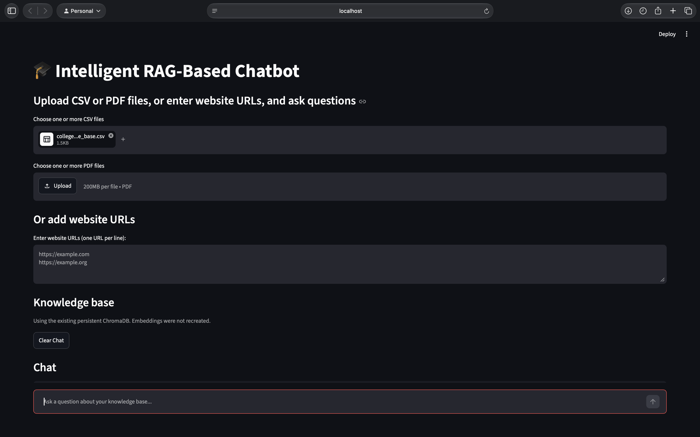
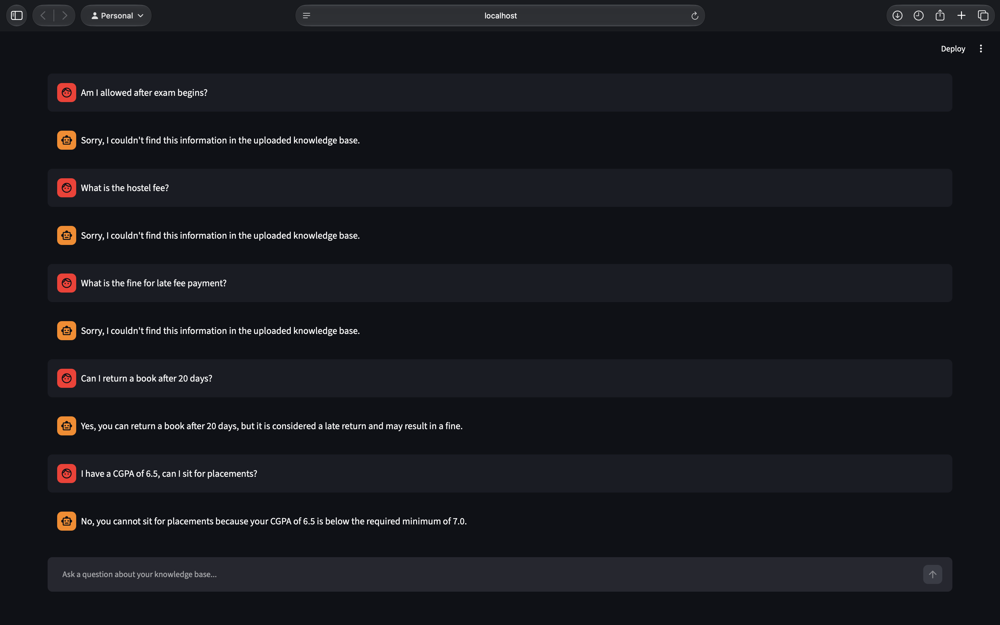
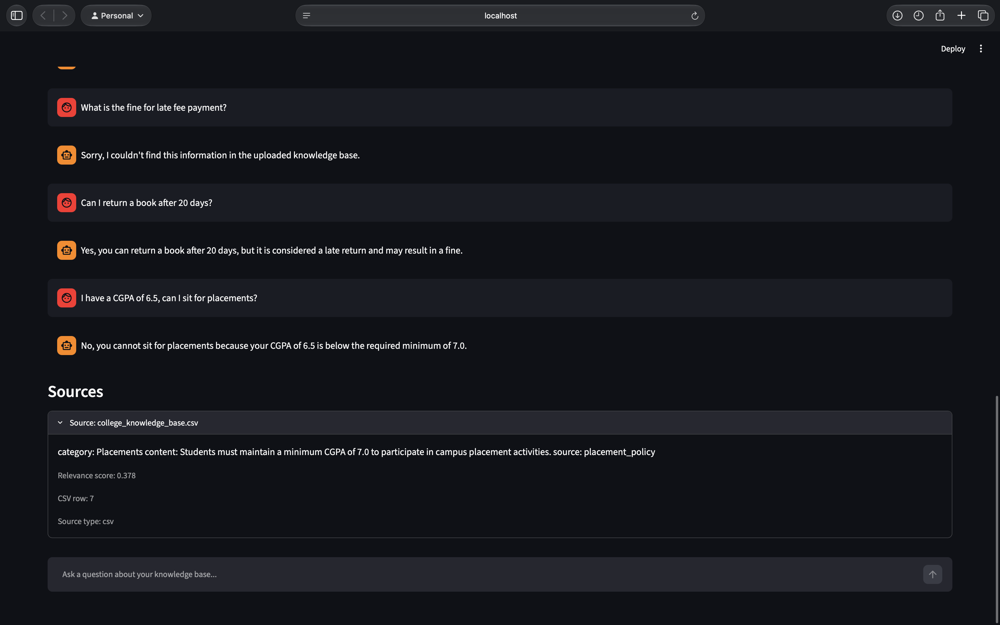

# Smart Knowledge RAG Chatbot

A Retrieval-Augmented Generation (RAG) chatbot that answers questions from
CSV files, PDFs and website URLs, with source citations.

## Features
- Upload CSV/PDF files or enter website URLs
- Persistent ChromaDB vector store (embeddings are not recreated)
- Follow-up question rewriting using chat history
- Relevance threshold with a fallback answer when nothing relevant is found
- Source display for every answer
- RAGAS evaluation of answer quality

## Tech Stack
Python, Streamlit, LangChain, ChromaDB, HuggingFace embeddings, Groq LLM, RAGAS

## How it works
Load documents -> split into chunks -> embed -> store in ChromaDB ->
retrieve top matches -> generate the answer with the LLM using retrieved context.

## Setup
1. Clone the repo
2. `pip install -r requirements.txt`
3. Create a `.env` file with `GROQ_API_KEY=your_key_here`
4. `streamlit run app.py`

## Evaluation

The chatbot was evaluated with [RAGAS](https://github.com/explodinggradients/ragas)
on a 10-question test set written from the college knowledge base
(`evaluate_rag.py`, results in `evaluation/`).

| Metric | Score | What it measures |
|---|---|---|
| Faithfulness | 0.90 | Whether the answer is supported by the retrieved context |
| Answer relevancy | 0.83 | Whether the answer addresses the question asked |

**Limitations:** the test set is small (10 questions) and the knowledge base is a
12-row sample dataset, so these scores show the pipeline works but are not a
guarantee of accuracy on larger or messier documents.

**Improvement made:** testing showed the model sometimes invented rules that were
not in the documents (for example, claiming late exam entry was banned). I changed
the prompt so it only draws conclusions from stated eligibility conditions, and
added a rule against mixing facts from different topics. The bot now says
"not mentioned" instead of guessing.

## Screenshots

